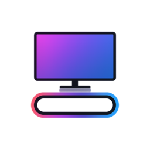
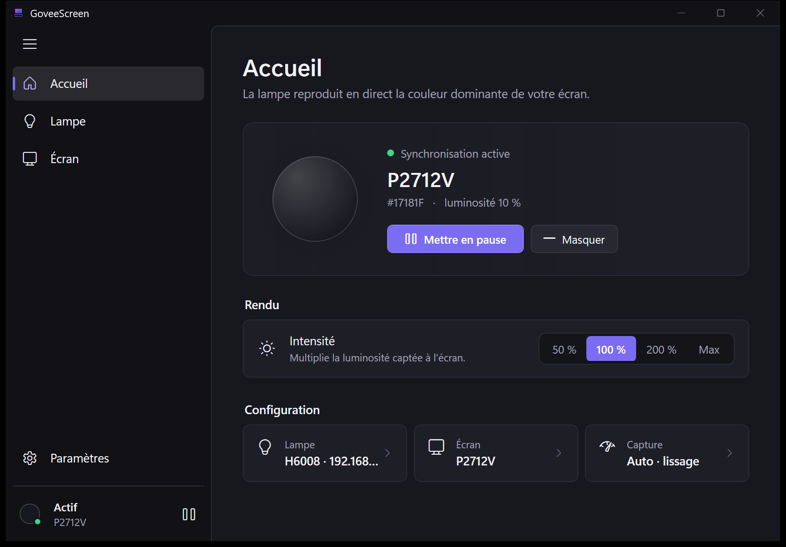
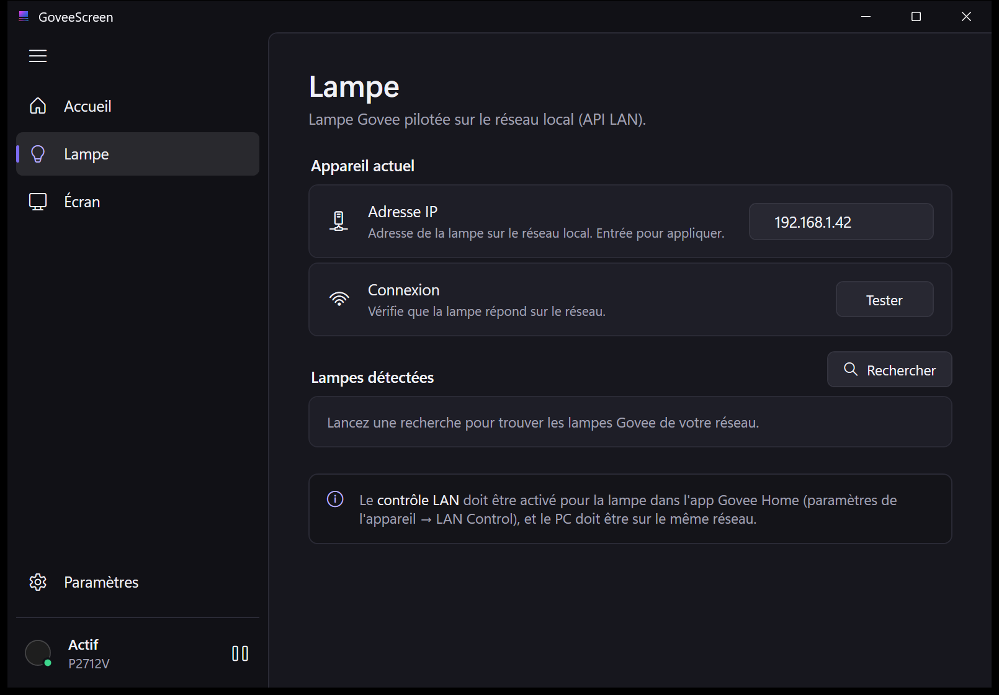
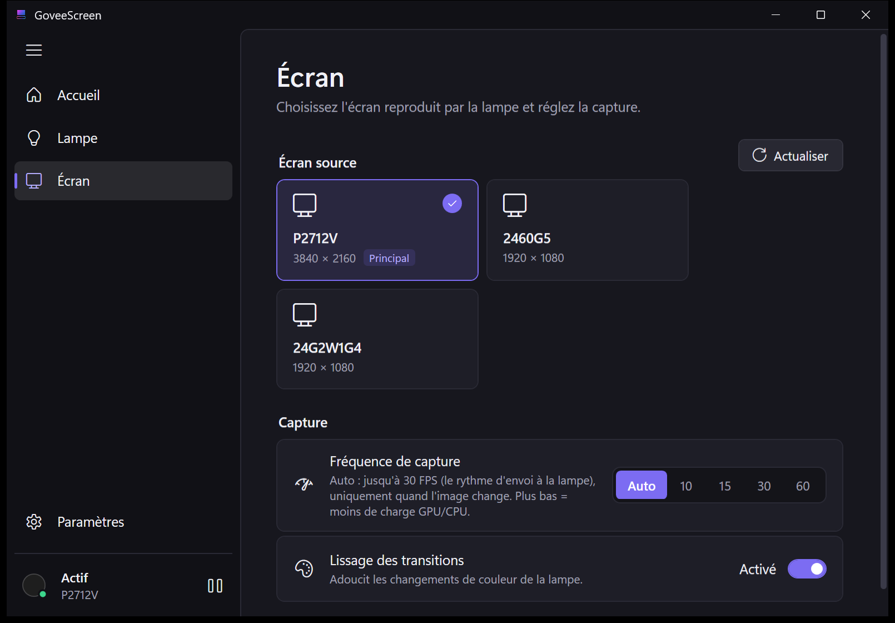
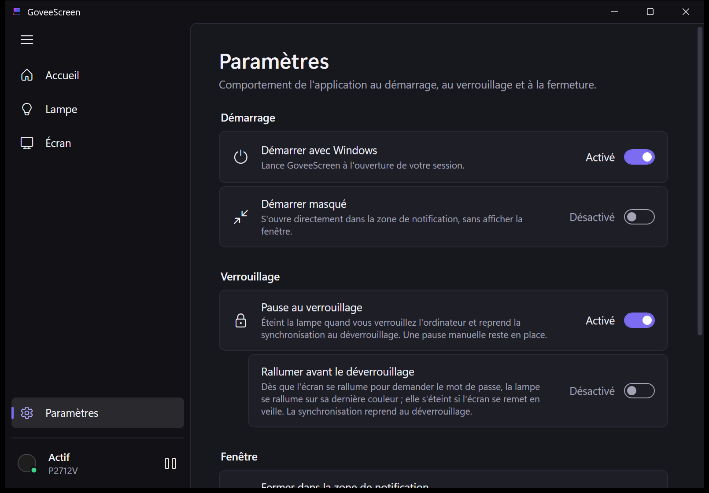

<p align="center">
  
</p>

<h1 align="center">GoveeScreen</h1>

<p align="center">
  Synchronise une lampe Govee avec les couleurs de votre écran, depuis une application Windows native et légère.
</p>

<p align="center">
  <a href="https://github.com/Baba0bab/GoveeScreen/actions/workflows/ci.yml"></a>
  <a href="https://github.com/Baba0bab/GoveeScreen/releases/latest"></a>
  <a href="LICENSE"></a>
  
</p>

<p align="center">
  <a href="README.md">🇬🇧 English</a> · 🇫🇷 Français
</p>

> L'interface est disponible en **anglais, français, allemand et espagnol**. Elle suit par défaut la langue d'affichage de Windows ; changez-la dans *Paramètres → Général → Langue*.

GoveeScreen lit la couleur dominante de votre écran et l'envoie à une lampe Govee sur votre réseau local : la lumière de la pièce suit ce que vous regardez ou ce à quoi vous jouez. L'application parle directement à la lampe via l'**API LAN** de Govee : pas de cloud, pas de compte, pas de clé d'API.



## Fonctionnalités

- **Capture GPU** (Windows.Graphics.Capture + Direct3D 11) : l'image reste en mémoire vidéo et un pixel shader la réduit en miniature ~160×90 (moyenne exacte par bloc) avant que quoi que ce soit n'arrive au processeur. Compatible jeux et vidéos en plein écran.
- **Quasiment aucune charge sur un écran fixe** : Windows ne fournit une image que si elle change, et la capture est entièrement libérée pendant la pause.
- **Cadence** : *Auto* (jusqu'à 30 FPS, le rythme accepté par la lampe) ou fixe 10 / 15 / 30 / 60 FPS, tenue précisément même sur écran 144 / 240 Hz (limitée à la source sous Windows 11 24H2+).
- **Plein écran exclusif** : si l'écran capturé reste noir 2 s (certains jeux anciens), GoveeScreen bascule sur la capture de la fenêtre du jeu, puis revient.
- **Moyenne intelligente** : bandes noires (letterbox) détectées et ignorées, barre des tâches exclue hors plein écran, transitions lissées (désactivable).
- **Détection des lampes** : trouve les lampes Govee du réseau (multicast) et teste la connexion.
- **Choix de l'écran** suivi par la lampe, avec le vrai nom commercial des moniteurs.
- **Intensité** : multiplicateur de luminosité 50 %, 100 %, 200 % ou *Max*.
- **Verrouillage de session** : en option, pause et lampe éteinte au verrouillage de Windows, rallumée dès que l'écran de verrouillage s'allume.
- **Zone de notification** : pause, intensité et écran depuis le menu de l'icône, sans ouvrir la fenêtre. Masquée, la fenêtre est détruite et l'application occupe environ 70 Mo.
- **Démarrage avec Windows**, éventuellement masqué.
- **Mises à jour automatiques** depuis les Releases GitHub : petits téléchargements delta, installés à la fermeture de l'application.
- **Langues** : anglais, français, allemand et espagnol, selon la langue d'affichage de Windows par défaut.
- Raccourcis : `Ctrl+1` … `Ctrl+4` pour changer de page, `Ctrl+P` pour pause / reprise.

| Lampe | Écran | Paramètres |
|---|---|---|
|  |  |  |

## Prérequis

| | |
|---|---|
| **Votre PC** | Windows 10 (version 2004 ou plus récente) ou Windows 11, x64. Rien d'autre à installer (le runtime .NET est inclus). |
| **Votre lampe** | Une lampe Govee compatible **API LAN** : dans l'app Govee Home, ouvrez les paramètres de l'appareil et activez **LAN Control**. Sans cet interrupteur, le modèle ne peut pas être piloté en local. |
| **Réseau** | Le PC et la lampe sur le même réseau local ; ports UDP 4001-4003 non bloqués par un pare-feu. |

## Installation

1. Téléchargez **`GoveeScreen-win-Setup.exe`** depuis la [dernière version](https://github.com/Baba0bab/GoveeScreen/releases/latest).
2. Lancez-le. L'application s'installe pour votre compte Windows uniquement, **sans droits administrateur**, dans `%LOCALAPPDATA%\GoveeScreen`, avec un raccourci dans le menu Démarrer et sur le bureau, puis démarre.

> **Windows SmartScreen** : l'installateur n'est pas signé, Windows peut afficher *« Windows a protégé votre ordinateur »*. Cliquez sur **Informations complémentaires → Exécuter quand même**. Chaque version publie `SHA256SUMS.txt` pour vérifier le téléchargement :
> ```powershell
> Get-FileHash .\GoveeScreen-win-Setup.exe -Algorithm SHA256
> ```

**Version portable** : `GoveeScreen-win-Portable.zip`, à extraire n'importe où, puis lancez `GoveeScreen.exe`. Elle se met à jour elle aussi.

### Mises à jour

L'application consulte les Releases GitHub au démarrage puis toutes les 12 heures, télécharge les nouvelles versions en arrière-plan (le plus souvent un petit *delta*) et les installe **à la fermeture de l'application**, ou tout de suite avec **Redémarrer et mettre à jour** (dans *Paramètres → Mises à jour*, dans le menu latéral ou dans le menu de l'icône). Vous pouvez désactiver la recherche ou l'installation automatique, et recevoir les préversions, dans la même section des paramètres.

### Désinstallation

*Paramètres Windows → Applications → Applications installées → GoveeScreen → Désinstaller*. L'application, ses raccourcis et le lancement avec Windows sont retirés. Vos réglages (`%APPDATA%\GoveeScreen`) sont **conservés** pour une future réinstallation : supprimez ce dossier pour les effacer aussi.

## Prise en main

1. Dans l'app Govee Home, activez **LAN Control** pour votre lampe.
2. Dans GoveeScreen, ouvrez **Lampe** et cliquez sur **Rechercher** : choisissez votre lampe dans la liste, ou tapez son adresse IP puis Entrée. **Tester** vérifie qu'elle répond.
3. Sur **Écran**, choisissez le moniteur que la lampe doit suivre.
4. C'est tout : la lampe suit votre écran. Fermez la fenêtre, GoveeScreen continue dans la zone de notification (clic gauche : ouvrir, clic droit : actions rapides).

Astuce : donnez une adresse IP fixe à la lampe (réservation DHCP dans votre box), sinon elle peut changer après un redémarrage de la box.

## Confidentialité

- Votre écran ne quitte jamais votre PC : chaque image est réduite en petite miniature en mémoire, et seule une couleur est envoyée à la lampe.
- Le trafic vers la lampe reste sur votre réseau local : commandes UDP (port 4003) et multicast de découverte (239.255.255.250, ports 4001 / 4002). Pas de compte, pas de télémétrie.
- La seule connexion à Internet est vers GitHub, pour rechercher les mises à jour de l'application ; elle se désactive dans *Paramètres → Mises à jour*.
- Les réglages sont dans `%APPDATA%\GoveeScreen\config.json`.

## Compiler depuis les sources

Prérequis : [SDK .NET 10](https://dotnet.microsoft.com/download/dotnet/10.0) et Windows 10 / 11.

```powershell
git clone https://github.com/Baba0bab/GoveeScreen.git
cd GoveeScreen
dotnet run                          # compile et lance (Debug)
dotnet test Tests                   # tests unitaires
```

Une copie lancée avec `dotnet run` n'est pas installée : les mises à jour automatiques y sont désactivées (la page des paramètres l'indique). Pour tester les mises à jour en local sans GitHub, lancez une copie installée ou portable avec `GOVEESCREEN_UPDATE_SOURCE` pointant vers un dossier de paquets construits par `scripts/pack.ps1`.

GoveeScreen n'autorise qu'une copie par dossier de données. Pour lancer une copie de développement à côté de la version installée sans toucher à ses réglages, démarrez l'exe compilé avec la variable d'environnement `GOVEESCREEN_HOME` pointant vers un autre dossier.

L'installateur et les paquets de mise à jour sont construits avec [Velopack](https://velopack.io) (`vpk`, version fixée dans [`dotnet-tools.json`](dotnet-tools.json)) par [`scripts/pack.ps1`](scripts/pack.ps1), le même script que le workflow de publication :

```powershell
./scripts/pack.ps1 -Version 2.0.0   # → Releases\GoveeScreen-win-Setup.exe, -Portable.zip, *.nupkg
```

Les versions sont publiées par GitHub Actions au push d'un tag de version, voir [docs/RELEASING.md](docs/RELEASING.md).

## Historique

GoveeScreen 2 est une réécriture complète en C# / .NET 10 + WPF de l'application Python d'origine (capture CPU avec `mss` + PIL, interface Tkinter). La version Python est conservée sur la branche [`v1-python`](https://github.com/Baba0bab/GoveeScreen/tree/v1-python). Ses réglages (`~/govee_config.json`) sont repris au premier lancement.

## Contribuer

Signalements de bugs, idées, traductions et pull requests sont les bienvenus, voir [CONTRIBUTING.md](CONTRIBUTING.md). Pour ajouter une langue, copiez `Localization/en.json` en `<code>.json`, traduisez les valeurs et ajoutez la langue à `Loc.Languages` dans `Core/Loc.cs`.

## Licence

Copyright © 2025-2026 Baba0bab. Distribué sous **GNU General Public License v3.0 ou ultérieure**, voir [LICENSE](LICENSE). Vous pouvez utiliser, étudier, modifier et redistribuer ce logiciel ; les versions modifiées distribuées doivent rester sous GPL et fournir leur code source.

Composants tiers (Vortice, Velopack…) : voir [THIRD-PARTY-NOTICES.md](THIRD-PARTY-NOTICES.md).

GoveeScreen est un projet indépendant, sans lien avec Govee ni approuvé par Govee. « Govee » est une marque de son propriétaire.
