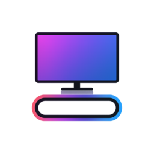
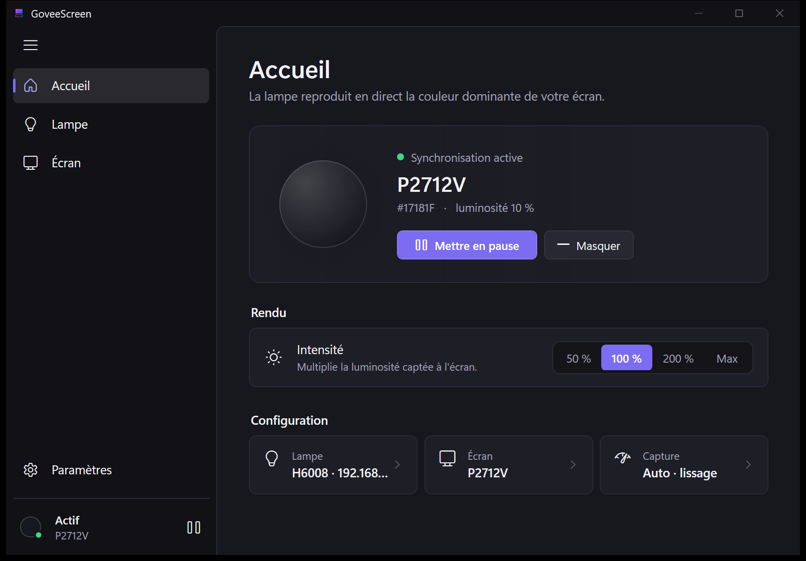
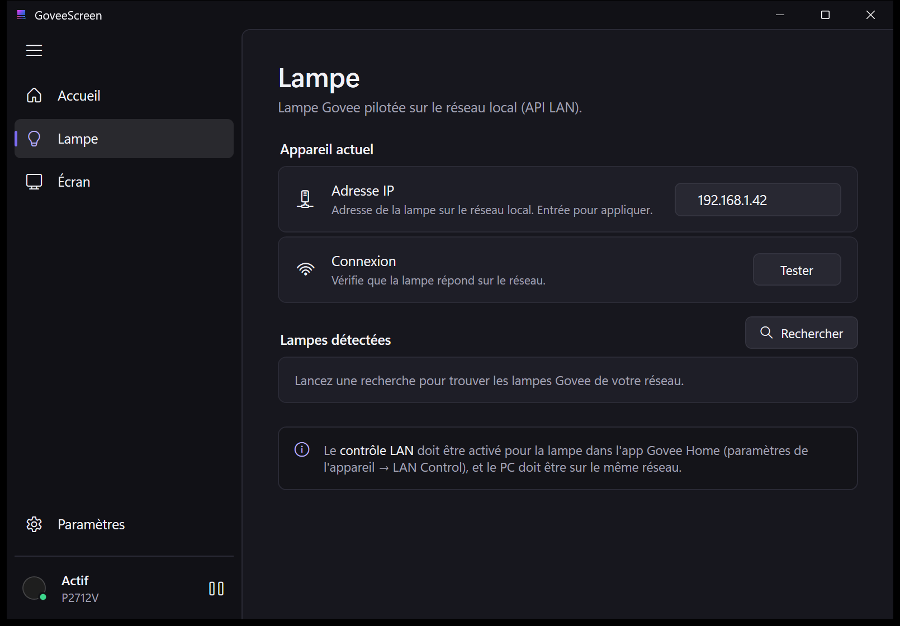
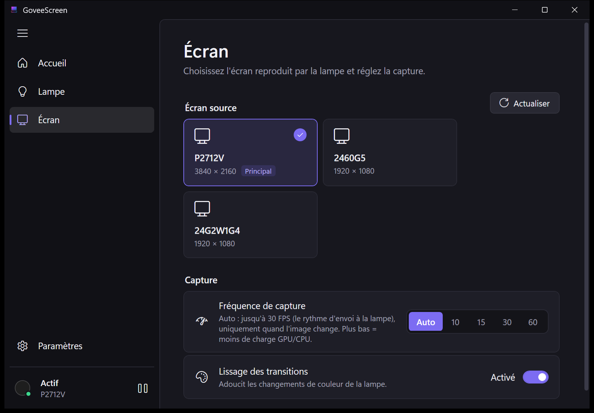
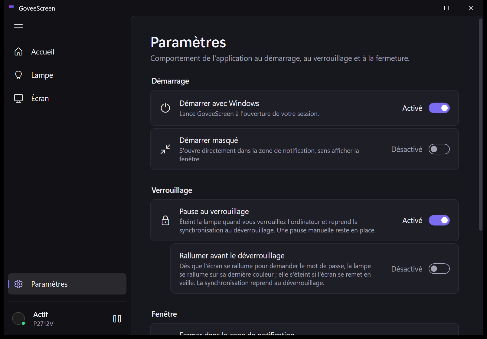

<p align="center">
  
</p>

<h1 align="center">GoveeScreen</h1>

<p align="center">
  Sync a Govee lamp with the colors of your screen, from a lightweight native Windows app.
</p>

<p align="center">
  <a href="https://github.com/Baba0bab/GoveeScreen/actions/workflows/ci.yml"></a>
  <a href="https://github.com/Baba0bab/GoveeScreen/releases/latest"></a>
  <a href="LICENSE"></a>
  
</p>

<p align="center">
  🇬🇧 English · <a href="README.fr.md">🇫🇷 Français</a>
</p>

> The interface is available in **English, French, German and Spanish**. It follows the Windows display language by default; change it in *Settings → General → Language*.

GoveeScreen reads the dominant color of your screen and sends it to a Govee light over your local network, so the light in your room follows what you watch or play. It talks to the lamp directly through Govee's **LAN API**: no cloud, no account, no API key.



## Features

- **GPU capture** (Windows.Graphics.Capture + Direct3D 11): the frame stays in video memory and a pixel shader shrinks it to a ~160×90 thumbnail (exact block average) before anything reaches the CPU. Works with games and videos in full screen.
- **Almost no CPU on a still screen**: Windows only delivers a frame when the image changes, and capture is released entirely while paused.
- **Frame rate**: *Auto* (up to 30 FPS, the rate the lamp accepts) or fixed 10 / 15 / 30 / 60 FPS, paced accurately even on 144 / 240 Hz displays (limited at the source on Windows 11 24H2+).
- **Exclusive full screen fallback**: if the captured display stays black for 2 s (some older games), GoveeScreen switches to capturing the game window, then switches back.
- **Smart averaging**: black bars (letterbox) are detected and ignored, the taskbar is left out outside full screen, colors are smoothed between frames (can be turned off).
- **Lamp discovery**: finds the Govee lights on your network (multicast) and tests the connection.
- **Display choice**: pick which monitor the lamp follows, with the monitors' real model names.
- **Intensity**: 50 %, 100 %, 200 % or *Max* brightness multiplier.
- **Session lock**: optionally pause and turn the lamp off when you lock Windows, and turn it back on as soon as the lock screen lights up.
- **System tray**: pause, intensity and display from the tray menu without opening the window. Hidden, the window is destroyed and the app uses about 70 MB.
- **Start with Windows**, optionally hidden in the tray.
- **Automatic updates** from GitHub Releases: small delta downloads, installed when you close the app.
- **Languages**: English, French, German and Spanish, following the Windows display language by default.
- Keyboard shortcuts: `Ctrl+1` … `Ctrl+4` to switch pages, `Ctrl+P` to pause / resume.

| Lamp | Display | Settings |
|---|---|---|
|  |  |  |

## Requirements

| | |
|---|---|
| **Your PC** | Windows 10 (version 2004 or later) or Windows 11, x64. Nothing else to install (the .NET runtime is bundled). |
| **Your lamp** | A Govee light that supports the **LAN API**: in the Govee Home app, open the device's settings and turn on **LAN Control**. If there is no such switch, the model cannot be controlled locally. |
| **Network** | The PC and the lamp on the same local network; UDP ports 4001-4003 not blocked by a firewall. |

## Installation

1. Download **`GoveeScreen-win-Setup.exe`** from the [latest release](https://github.com/Baba0bab/GoveeScreen/releases/latest).
2. Run it. The app is installed for your Windows account only, **without administrator rights**, in `%LOCALAPPDATA%\GoveeScreen`, with a Start menu and a desktop shortcut, then starts.

> **Windows SmartScreen**: the installer is not code-signed, so Windows may show *"Windows protected your PC"*. Click **More info → Run anyway**. Each release publishes `SHA256SUMS.txt` to check the download:
> ```powershell
> Get-FileHash .\GoveeScreen-win-Setup.exe -Algorithm SHA256
> ```

**Portable version**: `GoveeScreen-win-Portable.zip`, extract it anywhere and run `GoveeScreen.exe`. It can update itself too.

### Updates

The app checks GitHub Releases at startup and then every 12 hours, downloads new versions in the background (usually only a small *delta*) and installs them **when you close the app**, or right away with **Restart and update** (in *Settings → Updates*, in the side menu or in the tray icon's menu). You can turn off automatic checks or automatic installation, and opt in to pre-releases, in the same settings section.

### Uninstalling

*Windows Settings → Apps → Installed apps → GoveeScreen → Uninstall*. This removes the app, its shortcuts and the *start with Windows* entry. Your settings (`%APPDATA%\GoveeScreen`) are **kept** for a future reinstall: delete that folder to remove them too.

## Getting started

1. In the Govee Home app, turn on **LAN Control** for your lamp.
2. In GoveeScreen, open **Lamp** and click **Search**: pick your lamp in the list, or type its IP address and press Enter. **Test** checks that it answers.
3. On **Display**, choose the monitor the lamp should follow.
4. That's it: the lamp follows your screen. Close the window, GoveeScreen keeps running in the notification area (left click: open, right click: quick actions).

Tip: give the lamp a fixed IP address (DHCP reservation in your router), otherwise it may change after a reboot of the router.

## Privacy

- Your screen never leaves your PC: each frame is reduced to a small thumbnail in memory, and only one color is sent to the lamp.
- Lamp traffic stays on your local network: UDP commands to the lamp (port 4003) and the discovery multicast (239.255.255.250, ports 4001 / 4002). No account, no telemetry.
- The only internet connection is to GitHub, to check for app updates; it can be turned off in *Settings → Updates*.
- Settings are stored in `%APPDATA%\GoveeScreen\config.json`.

## Building from source

Prerequisites: [.NET 10 SDK](https://dotnet.microsoft.com/download/dotnet/10.0) and Windows 10 / 11.

```powershell
git clone https://github.com/Baba0bab/GoveeScreen.git
cd GoveeScreen
dotnet run                          # build and start (Debug)
dotnet test Tests                   # unit tests
```

A copy started with `dotnet run` is not installed: automatic updates are disabled there (the settings page says so). To test updates locally without GitHub, start an installed or portable copy with `GOVEESCREEN_UPDATE_SOURCE` set to a folder of packages built by `scripts/pack.ps1`.

GoveeScreen allows only one copy per data folder. To run a development copy next to an installed one without touching its settings, start the built exe with the `GOVEESCREEN_HOME` environment variable set to another folder.

The installer and the update packages are built with [Velopack](https://velopack.io) (`vpk`, pinned in [`dotnet-tools.json`](dotnet-tools.json)) by [`scripts/pack.ps1`](scripts/pack.ps1), the same script the release workflow runs:

```powershell
./scripts/pack.ps1 -Version 2.0.0   # → Releases\GoveeScreen-win-Setup.exe, -Portable.zip, *.nupkg
```

Releases are published by GitHub Actions when a version tag is pushed, see [docs/RELEASING.md](docs/RELEASING.md).

## Project structure

```
├─ Program.cs             entry point (installer / updater hooks, then WPF)
├─ Core/                  capture, analysis, lamp protocol, configuration (no UI)
│  ├─ ScreenCapturer.cs   GPU capture (Windows.Graphics.Capture + Direct3D 11), shader downscale
│  ├─ FrameAnalyzer.cs    black bars, average color, Rec. 709 brightness
│  ├─ SyncEngine.cs       capture → analysis → send loop (max 30 messages/s, only on change)
│  ├─ GoveeClient.cs      Govee LAN protocol (UDP 4003 commands, 4001 / 4002 discovery)
│  ├─ MonitorService.cs   DXGI enumeration and monitor model names
│  ├─ AppUpdater.cs       app updates from GitHub Releases (Velopack)
│  ├─ Loc.cs             translations (Localization/*.json, English fallback)
│  └─ SessionWatcher.cs   session lock / unlock and display power (Win32)
├─ UI/                    tray icon and its native menu (Win32), shared controls
├─ Localization/         interface texts: en.json (reference), fr.json, de.json, es.json
├─ Themes/Theme.xaml      colors and control styles
├─ AppController.cs       app lifecycle: config, lamp, engine, tray, window
├─ MainWindow.xaml        Home, Lamp, Display and Settings pages
├─ scripts/pack.ps1       installer and update packages (Velopack)
└─ Tests/                 xUnit tests
```

## History

GoveeScreen 2 is a complete rewrite in C# / .NET 10 + WPF of the original Python app (CPU capture with `mss` + PIL, Tkinter interface). The Python version is kept on the [`v1-python`](https://github.com/Baba0bab/GoveeScreen/tree/v1-python) branch. Its settings (`~/govee_config.json`) are imported on the first launch.

## Contributing

Bug reports, ideas, translations and pull requests are welcome, see [CONTRIBUTING.md](CONTRIBUTING.md). To add a language, copy `Localization/en.json` to `<code>.json`, translate the values and add the language to `Loc.Languages` in `Core/Loc.cs`.

## License

Copyright © 2025-2026 Baba0bab. Released under the **GNU General Public License v3.0 or later**, see [LICENSE](LICENSE). You may use, study, modify and redistribute this software; distributed modified versions must remain under the GPL and provide their source code.

Third-party components (Vortice, Velopack…) are listed in [THIRD-PARTY-NOTICES.md](THIRD-PARTY-NOTICES.md).

GoveeScreen is an independent project, not affiliated with or endorsed by Govee. "Govee" is a trademark of its owner.
